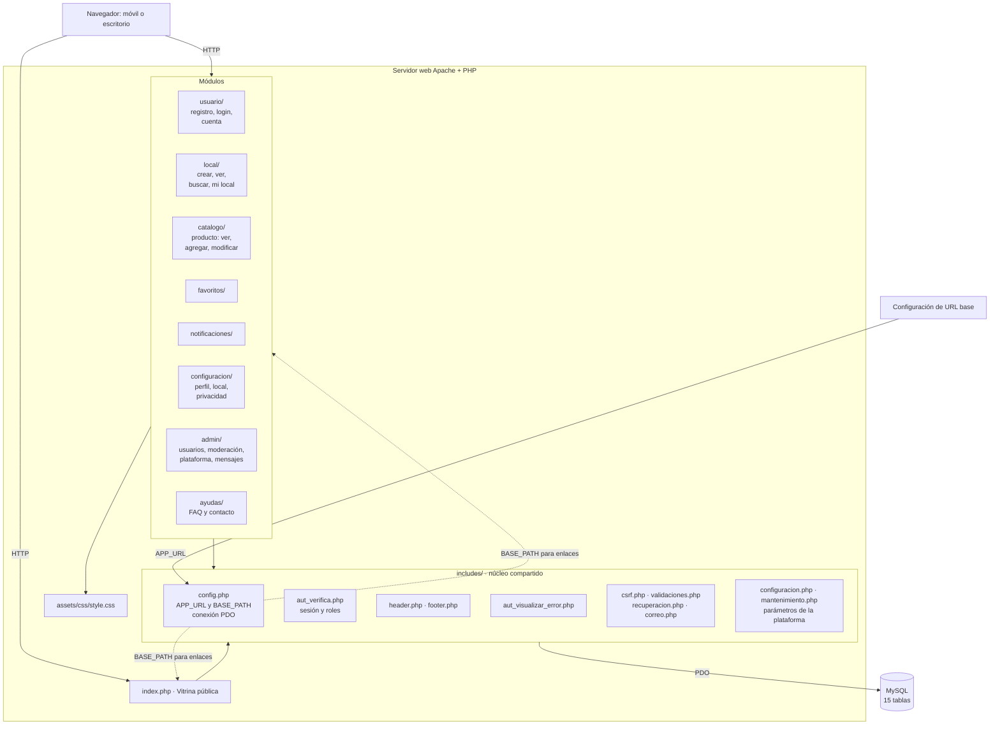

# Arquitectura y paquetes

Es una aplicación web en PHP, sin framework, sobre MySQL o MariaDB y servida con Apache (XAMPP mientras desarrollamos). Cada carpeta de la raíz del repositorio es un módulo.

Las rutas de la aplicación se configuran de forma centralizada mediante `APP_URL` y `BASE_PATH`, definidos en `includes/config.php` (Issue #10).

## Configuración de rutas

La aplicación utiliza dos constantes definidas en `includes/config.php`:

- `APP_URL`: dirección base de la aplicación.
- `BASE_PATH`: ruta base obtenida de `APP_URL` para construir enlaces internos y redirecciones.

Esto permite instalar Galezarzal en carpetas con distintos nombres sin modificar manualmente los enlaces de cada módulo.

### Ejemplos

| Instalación | APP_URL | BASE_PATH |
|---|---|---|
| Carpeta original | `http://localhost/galezarzal` | `/galezarzal` |
| Otra carpeta | `http://localhost/mitienda` | `/mitienda` |
| Dominio propio | `https://ejemplo.com` | Cadena vacía |

## Requerimientos relacionados

- **RNF-02 — Disponibilidad:** la configuración facilita cambiar la ubicación de despliegue, pero no garantiza el 95 % de disponibilidad.
- **RNF-05 — Escalabilidad:** la centralización de rutas permite trasladar la aplicación sin modificar los enlaces de cada módulo.

## Cosas que tener en cuenta

- Las rutas internas utilizan `BASE_PATH`, por lo que la carpeta en Apache no tiene que llamarse obligatoriamente `galezarzal`.
- Los roles son comprador, vendedor y administrador (tabla `rol`). El visitante es simplemente alguien sin sesión.
- No hay pasarela de pago: la compra se acuerda entre comprador y vendedor por WhatsApp o en persona.
- La compatibilidad completa con servidores Linux y Windows se trabaja por separado en RNF-11.
