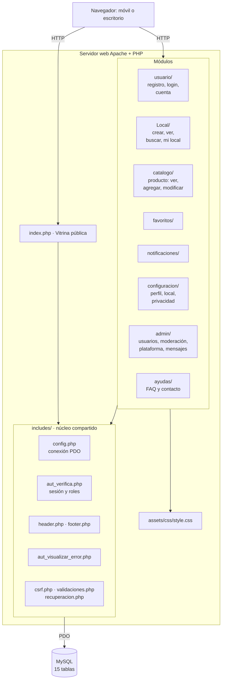

# Arquitectura y paquetes

Aplicación web en **PHP** (sin framework) sobre **MySQL/MariaDB**, servida con Apache (XAMPP en desarrollo). Cada carpeta de la raíz del repositorio es un módulo.

## Decisiones vigentes
- Las rutas internas usan el prefijo `/galezarzal/`: la carpeta publicada en Apache debe llamarse `galezarzal` (ver README).
- Roles: Comprador, Vendedor y Administrador (tabla `rol`); el visitante es un usuario sin sesión.
- Sin pasarela de pago: la compra se concreta entre comprador y vendedor (WhatsApp o presencial).
