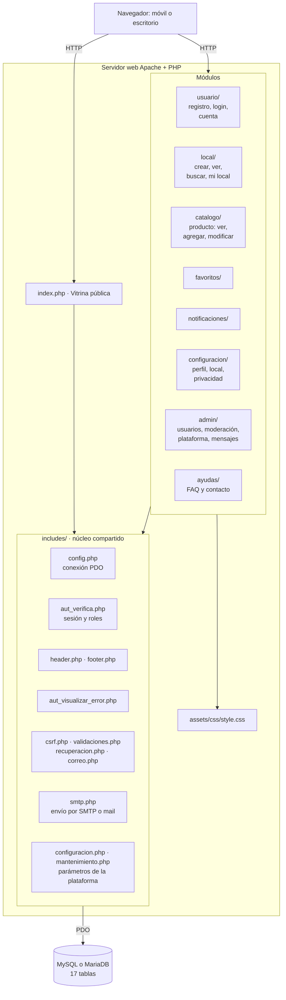
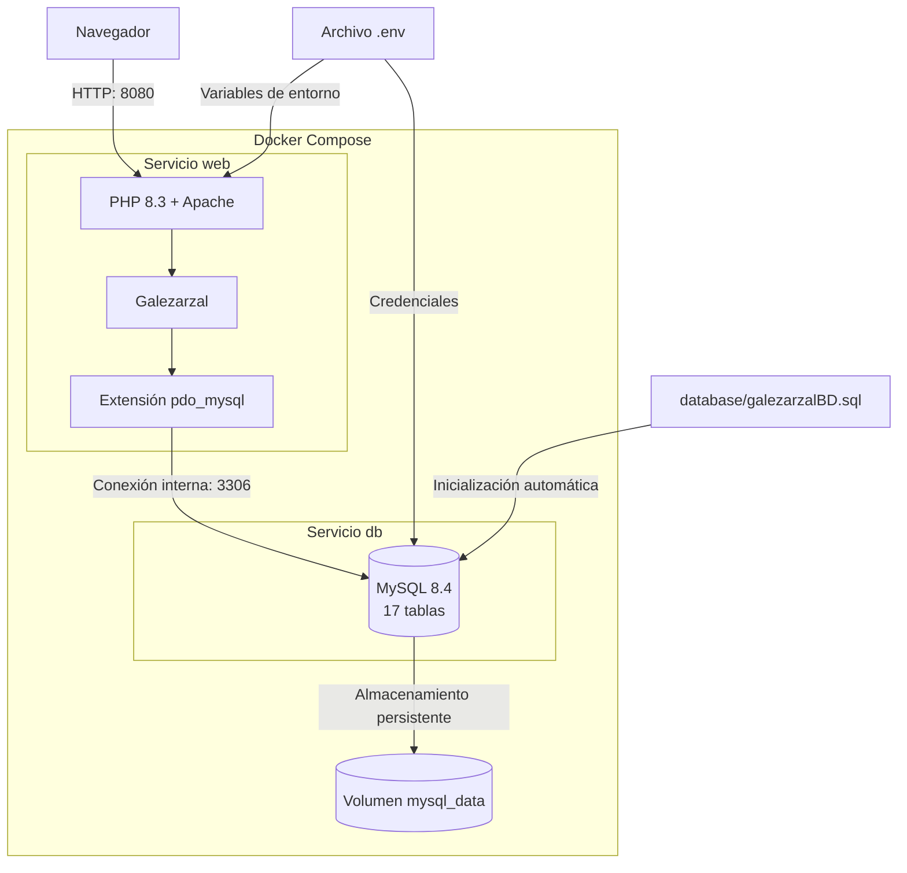

# Arquitectura y paquetes

Es una aplicación web en PHP, sin framework, sobre MySQL o MariaDB y servida con Apache. Para el desarrollo local se puede utilizar XAMPP o Docker Compose (Issue #43). Cada carpeta de la raíz del repositorio es un módulo.

## Arquitectura del entorno Docker

El entorno de desarrollo utiliza Docker Compose para gestionar dos servicios independientes: `web` y `db`. Esto permite tener un entorno de ejecución uniforme sin reemplazar la instalación tradicional con XAMPP.

### Componentes del entorno Docker

- `Dockerfile`: define la imagen de PHP 8.3 con Apache y la extensión `pdo_mysql`.
- `docker-compose.yml`: configura los servicios web y db, la red interna y el volumen de almacenamiento.
- `.env.example`: contiene un ejemplo de las variables de entorno necesarias.
- `.env`: contiene las credenciales locales y está excluido del repositorio mediante `.gitignore`.
- `.dockerignore`: evita copiar archivos innecesarios y configuraciones locales a la imagen Docker.
- `database/galezarzalBD.sql`: inicializa automáticamente la base de datos cuando se crea el volumen por primera vez.
- `mysql_data`: volumen que permite conservar la información al detener o recrear los contenedores.

### Comunicación entre servicios

El navegador accede a la aplicación mediante el puerto 8080 del equipo anfitrión. El servicio web se comunica con MySQL utilizando el nombre del servicio `db` y el puerto interno 3306.

El puerto de MySQL no se publica en el equipo anfitrión, evitando conflictos con la instalación local de XAMPP.

### Estado de integración

Durante el desarrollo del Issue #43 se realizaron las siguientes pruebas:

- Construcción de la imagen PHP 8.3 con Apache.
- Inicio de los servicios web y db.
- Importación automática de las 17 tablas.
- Verificación de los datos de ejemplo.
- Conexión directa entre PHP y MySQL mediante PDO.
- Conservación de los datos existentes al eliminar y recrear los contenedores.
- Carga de la página principal desde XAMPP.

La integración de las credenciales de la base de datos en la aplicación depende del Issue #18. Las pruebas del catálogo y la persistencia de cuentas nuevas desde Docker quedan pendientes hasta completar dicha integración.

## Cosas que tener en cuenta

- Las rutas internas usan el prefijo `/galezarzal/`, así que la carpeta en Apache tiene que llamarse `galezarzal` (está en el README).
- En Docker, el proyecto se encuentra en `/var/www/html/galezarzal`.
- Los roles son comprador, vendedor y administrador (tabla `rol`). El visitante es simplemente alguien sin sesión.
- No hay pasarela de pago: la compra se acuerda entre comprador y vendedor por WhatsApp o en persona.
- Docker y XAMPP utilizan bases de datos independientes.
- No se debe subir el archivo `.env` al repositorio.
- No se debe ejecutar `docker compose down -v` si se desea conservar la información de la base de datos.
