# Casos de uso por módulo

Mermaid no tiene diagrama UML de casos de uso, así que lo dibujamos como un mapa de qué casos de uso usa cada actor. El detalle original (descripciones y flujos) está en `docs/legacy/`.

Los actores son el visitante, el comprador (usuario registrado), el vendedor y el administrador. El vendedor y el administrador también pueden hacer lo que hace el comprador.

```mermaid
flowchart LR
    V([Visitante])
    C([Comprador])
    S([Vendedor])
    A([Administrador])

    subgraph CU1[CU1 Autenticación]
        direction TB
        CU11[Registrarse]
        CU12[Iniciar sesión]
        CU13[Restablecer contraseña]
        CU14[Cerrar sesión]
    end
    subgraph CU2[CU2 Locales]
        direction TB
        CU24[Buscar local]
        CU25[Ver local]
        CU21[Crear local]
        CU22[Modificar local]
        CU23[Eliminar local]
    end
    subgraph CU3[CU3 Catálogo]
        direction TB
        CU31[Consultar catálogo]
        CU32[Buscar producto]
        CU33[Agregar producto]
        CU34[Modificar producto]
        CU35[Eliminar producto]
        CU36[Cambiar estado producto]
    end
    subgraph CU4[CU4 Favoritos]
        direction TB
        CU41[Agregar a favoritos]
        CU42[Eliminar favorito]
        CU43[Consultar favoritos]
    end
    subgraph CU5[CU5 Notificaciones]
        direction TB
        CU51[Consultar]
        CU52[Marcar como leída]
        CU53[Eliminar]
    end
    subgraph CU6[CU6 Configuración de usuario]
        direction TB
        CU61[Modificar perfil]
        CU62[Cambiar contraseña]
        CU63[Configurar notificaciones]
        CU64[Configurar privacidad]
    end
    subgraph CU7[CU7 Administración]
        direction TB
        CU71[Gestionar usuarios]
        CU72[Moderar locales]
        CU73[Moderar productos]
        CU74[Configurar plataforma]
    end
    subgraph CU8[CU8 Ayudas y contacto]
        direction TB
        CU81[Preguntas frecuentes]
        CU82[Guías de uso]
        CU83[Enviar formulario PQR]
    end

    V --> CU11 & CU12 & CU13 & CU24 & CU25 & CU31 & CU32 & CU81 & CU82 & CU83
    C --> CU14 & CU41 & CU42 & CU43 & CU51 & CU52 & CU53 & CU61 & CU62 & CU63 & CU64
    S --> CU21 & CU22 & CU33 & CU34 & CU35 & CU36
    A --> CU23 & CU71 & CU72 & CU73 & CU74
```

